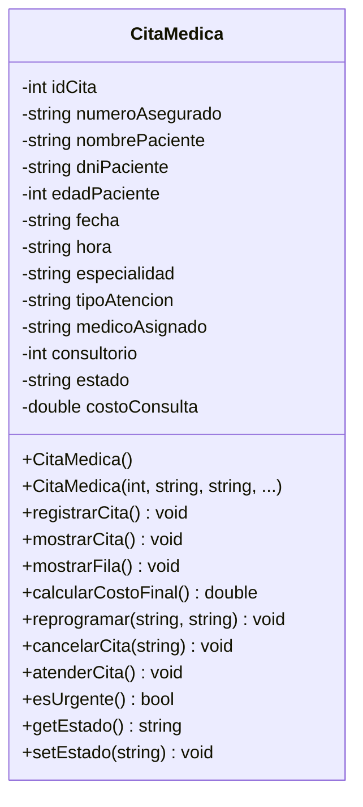

# Ejercicio 3 — Diseño gráfico de la clase `CitaMedica`

Dominio: gestión de **citas médicas de un hospital / clínica del asegurado**.

---

## 1. Diagrama UML (notación clásica)

```
+--------------------------------------------------------------+
|                        CitaMedica                            |
+--------------------------------------------------------------+
| - idCita              : int                                  |
| - numeroAsegurado     : string      // N° de seguro (SIS/EsSalud)
| - nombrePaciente      : string                               |
| - dniPaciente         : string                               |
| - edadPaciente        : int                                  |
| - fecha               : string      // dd/mm/aaaa            |
| - hora                : string      // hh:mm                 |
| - especialidad        : string      // Cardiologia, Pediatria...
| - tipoAtencion        : string      // Consulta/Control/Emergencia
| - medicoAsignado      : string                               |
| - consultorio         : int                                  |
| - estado              : string      // PENDIENTE/ATENDIDA/CANCELADA
| - costoConsulta       : double                               |
+--------------------------------------------------------------+
| + CitaMedica()                       <<constructor por defecto>>
| + CitaMedica(id, asegurado, ...)     <<constructor parametrizado>>
| + registrarCita()          : void    // pide datos por consola
| + mostrarCita()            : void    // imprime la ficha       
| + mostrarFila()            : void    // imprime en formato tabla
| + calcularCostoFinal()     : double  // aplica descuento del seguro
| + reprogramar(f, h)        : void    // cambia fecha y hora     
| + cancelarCita(motivo)     : void    // estado -> CANCELADA     
| + atenderCita()            : void    // estado -> ATENDIDA      
| + esUrgente()              : bool    // true si es Emergencia   
| + getEstado() / setEstado()          <<accesores>>             
+--------------------------------------------------------------+
```

---

## 2. Mismo diagrama en Mermaid



---

## 3. Descripción de los atributos

| Atributo          | Tipo   | Descripción                                                |
|-------------------|--------|------------------------------------------------------------|
| `idCita`          | int    | Correlativo único de la cita.                              |
| `numeroAsegurado` | string | Código del asegurado (autogenerado/entregado por el seguro).|
| `nombrePaciente`  | string | Nombres y apellidos del paciente.                          |
| `dniPaciente`     | string | Documento de identidad (8 dígitos).                        |
| `edadPaciente`    | int    | Edad; sirve para el descuento del adulto mayor.            |
| `fecha`           | string | Fecha programada `dd/mm/aaaa`.                             |
| `hora`            | string | Hora programada `hh:mm`.                                   |
| `especialidad`    | string | Servicio médico solicitado.                                |
| `tipoAtencion`    | string | `Consulta`, `Control` o `Emergencia`.                      |
| `medicoAsignado`  | string | Médico que atenderá la cita.                               |
| `consultorio`     | int    | Número de consultorio.                                     |
| `estado`          | string | `PENDIENTE`, `ATENDIDA` o `CANCELADA`.                     |
| `costoConsulta`   | double | Tarifa base antes de aplicar la cobertura del seguro.       |

## 4. Reglas de negocio aplicadas en los métodos

- `calcularCostoFinal()`: **Emergencia** paga 100 % de la tarifa,
  **Consulta** 70 %, **Control** 50 %. Además, si `edadPaciente >= 65`
  se aplica un 10 % de descuento adicional (adulto mayor).
- `esUrgente()`: devuelve `true` sólo si `tipoAtencion == "Emergencia"`.
- `cancelarCita()` y `atenderCita()` sólo tienen efecto si la cita está
  en estado `PENDIENTE`.

Esta misma clase se implementa con `struct` en el **Ejercicio 4**
y con `class` en el **Ejercicio 5**.
